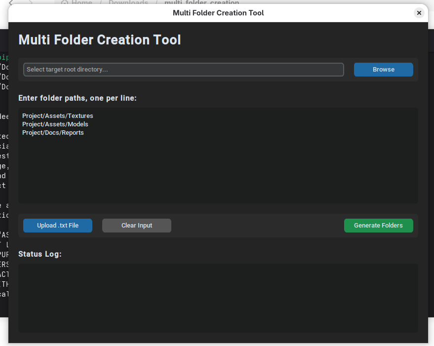

# Multi Folder Creation Tool

A modern desktop application built with Python and CustomTkinter to automate the creation of complex folder structures. This tool allows users to generate multiple folders simultaneously by providing a list of paths manually or via a text file.

## Features

- **Recursive Folder Creation:** Create nested directory structures automatically.
- **Batch Processing:** Enter multiple paths at once, one per line.
- **File Integration:** Load folder paths directly from `.txt` files.
- **Modern UI:** Clean, dark-themed interface with responsive layout.
- **Cross-Platform Compatibility:** Normalizes paths to work across Windows, macOS, and Linux.
- **Status Logging:** Real-time feedback on folder creation success and errors.

## Preview

### Main Interface


## Installation

### Prerequisites
- Python 3.11 or higher
- `pip` (Python package manager)

### Setup
1. Clone or download this repository.
2. Install the required dependencies:
   ```bash
   pip install -r requirement.txt
   ```

## Usage

1. **Launch the Application:**
   Run the `source_code.py` script:
   ```bash
   python source_code.py
   ```
   *Note: If you are on Windows, you can also use the provided `main.exe`.*

2. **Select Root Directory:**
   Click the **Browse** button to select the parent folder where you want your new directories to be created.

3. **Input Folder Paths:**
   - Type the desired paths in the main text area (one path per line).
   - Alternatively, click **Upload .txt File** to import a list of paths.
   - Example format: `Project/Assets/Textures`

4. **Generate:**
   Click **Generate Folders**. The status log will show the progress and any errors encountered.

## Project Structure
- `source_code.py`: The main application logic and UI.
- `requirement.txt`: List of Python dependencies.
- `images/`: Contains UI screenshots for documentation.
- `icon/`: Application icons.

## License
MIT License, Feel free to modify. 
