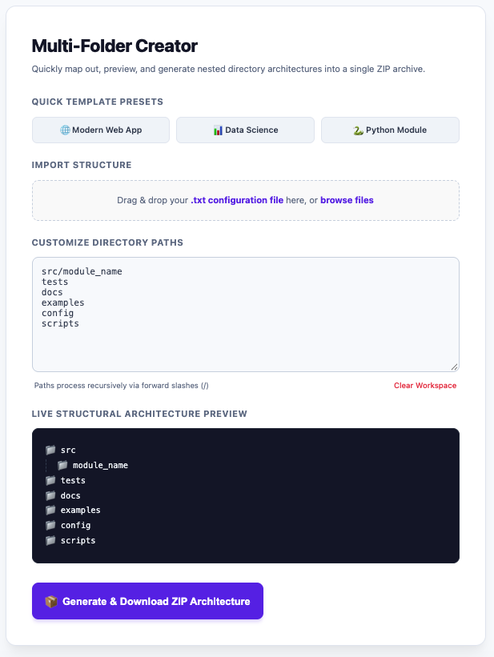

# 📁 Multi-Folder Creator — JavaScript Edition

**Create complex folder structures in seconds. Preview them instantly. Download everything as a ZIP archive.**

Multi-Folder Creator is a lightweight, browser-based tool that helps developers plan and generate nested directory structures without manually creating folders one by one. Use predefined templates or import a text file containing directory paths, preview the structure, and download it as a ZIP archive.

**[Live Demo](https://abyshergill.github.io/Multi_Folder_Creator/)** · **[Source Code](https://github.com/abyshergill/Multi_Folder_Creator)**



## ✨ Features

- **📂 Nested Folder Creation** — Define multi-level directory structures quickly and easily.
- **⚡ Ready-to-Use Templates** — Start with predefined structures for modern web applications, data science projects, and Python modules.
- **👀 Live Structure Preview** — Visualize your directory hierarchy before generating the ZIP archive.
- **📄 Import Folder Structures** — Drag and drop or browse for `.txt` files containing directory paths.
- **📦 ZIP Archive Generation** — Package the generated directory structure into a single downloadable ZIP file.
- **🌐 Browser-Based** — Use the tool directly in your browser without setting up a backend server.

## 🚀 Getting Started

### Option 1: Use the Live Demo

Open the application in your browser:

**[Launch Multi-Folder Creator](https://abyshergill.github.io/Multi_Folder_Creator/)**

### Option 2: Run Locally

**1. Clone the repository**

```bash
git clone https://github.com/abyshergill/Multi_Folder_Creator.git
```

**2. Navigate to the project directory**

```bash
cd Multi_Folder_Creator
```

**3. Launch the application**

Open `index.html` in your web browser.

No Node.js installation or backend server is required for the basic browser-based workflow.

## 🛠️ How to Use

1. Open Multi-Folder Creator in your browser.
2. Select a predefined template or enter your desired directory structure.
3. Alternatively, import a `.txt` file containing directory paths.
4. Review the live preview to verify the folder hierarchy.
5. Generate and download the ZIP archive.
6. Extract the archive to use your newly organized directory structure.

## 📝 Example Folder Structure

For example, a generated project structure could look like this:

```text
my-project/
├── src/
│   ├── components/
│   ├── services/
│   └── utils/
├── tests/
├── docs/
├── assets/
└── README.md
```

This is an illustrative example of a directory structure the tool can help you organize.

## 🧰 Technology Stack

- **HTML5** — Application structure
- **CSS3** — Styling and layout
- **JavaScript** — Application logic and directory-tree generation
- **JSZip** — Creating ZIP archives directly in the browser

## 📂 Project Structure

```text
Multifolder_Creation_Javascript_Edition/
├── css/
│   └── style.css
├── js/
│   └── script.js
├── index.html
└── README.md
```

## 🎯 Use Cases

Multi-Folder Creator can help with:

- Setting up new software projects.
- Creating standardized directory structures for teams.
- Organizing Python, data science, and web development projects.
- Preparing reusable project templates.
- Generating nested directory structures for repetitive workflows.

## 🤝 Contributing

Contributions, suggestions, and bug reports are welcome!

1. Fork this repository.
2. Create a feature branch.
3. Make your changes.
4. Test the application in your browser.
5. Submit a pull request describing your improvements.

## 📄 License

Please refer to the repository's license file, if available, for the applicable usage and distribution terms.

## 👨‍💻 Author

**Abyshergill**

- GitHub: [@abyshergill](https://github.com/abyshergill)
- Project: [Multi-Folder Creator — JavaScript Edition](https://github.com/abyshergill//Multi_Folder_Creator)

---

⭐ If you find this project useful, consider giving the repository a star!